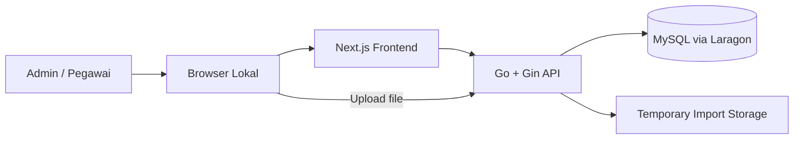
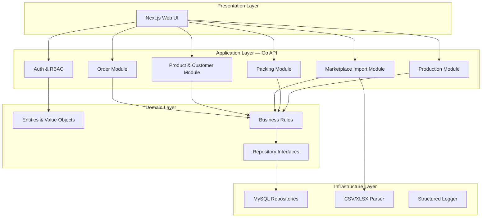
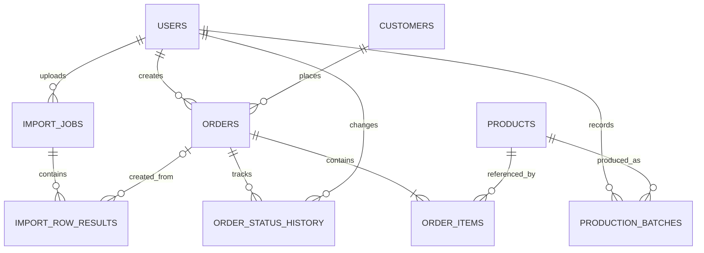
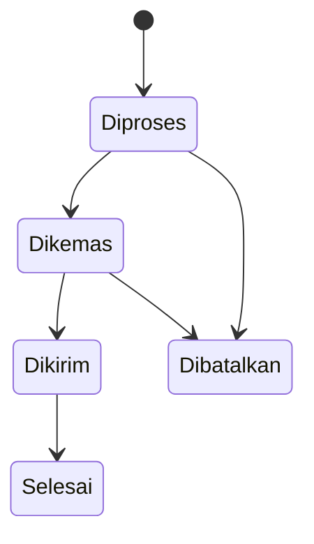
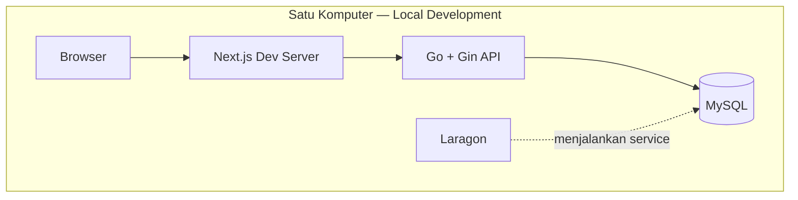

# Architecture Document
## Sistem Pencatatan Pesanan Terpadu — Ratu Kriuk

| Metadata | Nilai |
|---|---|
| Dokumen | Software Architecture Document |
| Produk | Sistem Pencatatan Pesanan Terpadu Ratu Kriuk |
| Versi | 1.1 — Local Development Scope |
| Status | Rancangan awal, menunggu validasi kebutuhan |
| Basis | Dokumen UML Artifacts Ratu Kriuk, 2026 |
| Target eksekusi | Lokal pada komputer pengembang/pengguna |
| Database lokal | MySQL melalui Laragon |

---

## 1. Tujuan dan Prinsip Arsitektur

Dokumen ini menjelaskan rancangan teknis untuk membangun aplikasi web internal Ratu Kriuk. Arsitektur mendukung alur pesanan manual, impor file marketplace, pengelolaan status, daftar packing, dan pencatatan batch produksi.

Untuk tahap proyek saat ini, aplikasi ditargetkan berjalan **secara lokal terlebih dahulu**. Frontend dan backend dijalankan pada komputer yang sama, sedangkan service MySQL dijalankan melalui Laragon. Deployment ke VPS, cloud, atau hosting publik tidak termasuk scope awal.

Prinsip:
1. **Modular monolith** — satu backend API dengan batas modul domain yang jelas.
2. **Server sebagai sumber kebenaran** — validasi, perhitungan uang, role, dan transisi status dilakukan di backend.
3. **Data transaksi konsisten** — pesanan dan detail disimpan dalam transaksi database.
4. **Impor dapat diaudit dan idempotent** — file yang sama tidak boleh membuat pesanan ganda.
5. **Role-based access control (RBAC)** — akses Admin/Owner dan Pegawai dibatasi di server.
6. **UI operasional** — formulir dan daftar dibuat ringkas, responsif, serta mudah digunakan.
7. **Local-first** — setup development harus dapat dijalankan dari satu komputer dengan instruksi yang konsisten.
8. **Evolusi bertahap** — hosting online, integrasi marketplace API, dan fitur inventaris tidak dipaksakan ke MVP.

## 2. Batas Sistem dan Konteks

### 2.1 Aktor
- Admin/Owner
- Pegawai (termasuk pegawai bagian produksi)

### 2.2 Komponen Lokal
- Browser pada komputer lokal
- Next.js Web Frontend
- Go + Gin Backend API
- MySQL Server yang dijalankan melalui Laragon
- Folder sementara untuk file impor

### 2.3 Sistem Eksternal
Tidak ada integrasi eksternal yang diwajibkan dokumen sumber. Marketplace pada MVP diperlakukan sebagai asal file ekspor yang diunggah Admin, bukan koneksi API langsung.



Seluruh komponen aplikasi dijalankan di komputer lokal. Akses dari perangkat lain melalui jaringan lokal belum termasuk scope kecuali diputuskan kemudian.

## 3. Stack Teknologi yang Direkomendasikan

Stack berikut merupakan rekomendasi implementasi, bukan teknologi yang ditentukan oleh dokumen UML.

| Lapisan | Pilihan | Alasan |
|---|---|---|
| Frontend | Next.js (App Router) + TypeScript | Struktur aplikasi web, routing, komponen, dan ekosistem matang. |
| UI | Tailwind CSS + shadcn/ui | Konsistensi komponen dan percepatan implementasi dashboard/form. |
| Form & validasi UI | React Hook Form + Zod | Validasi deklaratif dan typed form. |
| Data fetching | TanStack Query | Cache, loading/error state, dan invalidasi setelah mutasi. |
| Backend | Go + Gin | API ringan, performa baik, cocok untuk domain CRUD dan proses impor. |
| Database | MySQL 8.x melalui Laragon | Database relasional yang dapat dijalankan lokal sesuai lingkungan yang tersedia. |
| Database driver | `go-sql-driver/mysql` melalui `database/sql` | Koneksi backend Go ke MySQL. |
| Database migration | `golang-migrate` atau tool migrasi SQL setara | Perubahan skema dapat dilacak dan dijalankan berulang secara terkontrol. |
| Password hashing | Argon2id atau bcrypt | Password tidak disimpan sebagai teks biasa. |
| File parsing | Go CSV package; library XLSX bila format XLSX disetujui | Parsing dan validasi file dilakukan di backend. |
| Testing | Go test dan Playwright | Unit, integration, API, dan end-to-end test. |
| Local runtime | Laragon + terminal | Laragon menjalankan MySQL; frontend/backend dijalankan dari terminal. |

**Catatan database:** rancangan ini menargetkan MySQL 8.x dengan InnoDB. Periksa nama engine dan versi server yang benar-benar terpasang di Laragon. Jika yang tersedia adalah MariaDB, lakukan verifikasi kompatibilitas migration dan query sebelum menetapkannya sebagai database final.

### 3.1 Setup Database Lokal dengan Laragon

1. Buka Laragon dan jalankan service MySQL.
2. Periksa versi database dan port yang aktif dari konfigurasi Laragon.
3. Buat database proyek, misalnya `ratu_kriuk`.
4. Buat user database khusus development bila memungkinkan. Untuk development pribadi, akun lokal dapat digunakan sesuai konfigurasi Laragon, tetapi jangan mengandalkan kredensial default yang belum diverifikasi.
5. Atur konfigurasi koneksi melalui file `.env` lokal yang tidak di-commit.
6. Jalankan migration backend untuk membuat tabel.
7. Jalankan pemeriksaan koneksi dari backend.

Contoh `.env` (sesuaikan dengan Laragon di komputer masing-masing):

```env
APP_ENV=development
API_PORT=8080

DB_HOST=127.0.0.1
DB_PORT=3306
DB_NAME=ratu_kriuk
DB_USER=your_local_user
DB_PASSWORD=your_local_password
DB_TIMEZONE=UTC

UPLOAD_MAX_BYTES=10485760
UPLOAD_TEMP_DIR=./storage/imports
```

Contoh DSN Go menggunakan `go-sql-driver/mysql`:

```text
your_local_user:your_local_password@tcp(127.0.0.1:3306)/ratu_kriuk?parseTime=true&charset=utf8mb4&loc=UTC
```

Jangan menaruh kredensial asli di repository. Tambahkan `.env` ke `.gitignore` dan sediakan `.env.example` dengan placeholder.

### 3.2 Konvensi Skema MySQL

- Gunakan storage engine `InnoDB`.
- Gunakan character set `utf8mb4`.
- Gunakan `DECIMAL(14,2)` untuk nilai uang, bukan `FLOAT` atau `DOUBLE`.
- Gunakan UUID yang dibuat aplikasi dan disimpan sebagai `CHAR(36)` untuk ID pada versi awal.
- Gunakan `DATETIME(3)` dengan konvensi penyimpanan UTC; konversi ke zona waktu tampilan dilakukan di aplikasi.
- Gunakan foreign key, unique index, dan constraint untuk menjaga integritas.
- Validasi domain tetap dilakukan di backend.
- Pastikan migration cocok dengan versi MySQL yang digunakan seluruh anggota.

## 4. Gaya Arsitektur

Gunakan **modular monolith dengan layered boundaries**.



### 4.1 Modul Domain

- **Identity**: autentikasi, pengguna, role, sesi.
- **Catalog**: produk dan pelanggan.
- **Orders**: pesanan, detail pesanan, perhitungan total, perubahan status.
- **Marketplace Import**: upload, parsing, validasi, deduplikasi, hasil impor.
- **Packing**: antrean pesanan belum dikemas dan aksi tandai dikemas.
- **Production**: catatan hasil produksi per batch.
- **Audit**: pencatatan aktivitas penting.

Semua modul berada dalam satu backend API untuk MVP. Tidak perlu microservices.

## 5. Struktur Repository yang Diusulkan

```text
ratu-kriuk/
├── apps/
│   └── web/
│       ├── app/
│       │   ├── (auth)/login/
│       │   ├── (admin)/dashboard/
│       │   ├── (admin)/orders/
│       │   ├── (admin)/orders/new/
│       │   ├── (admin)/imports/
│       │   ├── (admin)/products/
│       │   ├── (admin)/customers/
│       │   ├── (admin)/production/
│       │   └── (employee)/packing/
│       ├── components/
│       ├── features/
│       ├── lib/
│       └── styles/
├── services/
│   └── api/
│       ├── cmd/api/
│       ├── internal/
│       │   ├── auth/
│       │   ├── users/
│       │   ├── catalog/
│       │   ├── orders/
│       │   ├── imports/
│       │   ├── packing/
│       │   ├── production/
│       │   ├── audit/
│       │   ├── platform/
│       │   └── http/
│       ├── migrations/
│       └── tests/
├── docs/
│   ├── PRD.md
│   ├── ARCHITECTURE.md
│   └── TASKS.md
├── .env.example
├── .gitignore
└── README.md
```

Struktur ini adalah starting point. Jangan membuat folder/package kosong hanya demi memenuhi diagram; tambahkan ketika modul mulai diimplementasikan.

## 6. Model Domain dan Database

### 6.1 Entitas

Entitas inti mengikuti Class Diagram sumber (halaman 16): Pengguna, Admin, Pegawai, Pelanggan, Pesanan, Detail Pesanan, Produk, dan Hasil Produksi.

Rancangan relasional berikut menambahkan atribut teknis untuk mendukung kebutuhan operasional.

#### users

| Kolom | Tipe | Keterangan |
|---|---|---|
| id | CHAR(36) PK | UUID pengguna |
| username | VARCHAR(80) UNIQUE | Username login |
| password_hash | VARCHAR(255) | Hash password |
| role | VARCHAR(30) | `ADMIN` atau `EMPLOYEE` |
| full_name | VARCHAR(150) | Nama tampilan |
| is_active | BOOLEAN | Status akun |
| created_at, updated_at | DATETIME(3) | Audit waktu |

#### customers

| Kolom | Tipe | Keterangan |
|---|---|---|
| id | CHAR(36) PK | UUID pelanggan |
| name | VARCHAR(150) | Nama pelanggan |
| phone | VARCHAR(30) | Kontak |
| address | TEXT | Alamat |
| city/region/postal_code | VARCHAR | Data tujuan untuk ongkir bila diperlukan |
| created_at, updated_at | DATETIME(3) | Audit waktu |

#### products

| Kolom | Tipe | Keterangan |
|---|---|---|
| id | CHAR(36) PK | UUID produk |
| sku | VARCHAR(80) UNIQUE | Kode produk untuk pencocokan impor bila digunakan |
| name | VARCHAR(150) | Nama produk |
| description | TEXT NULL | Deskripsi opsional |
| unit_price | DECIMAL(14,2) | Harga jual saat ini |
| is_active | BOOLEAN | Produk aktif |
| created_at, updated_at | DATETIME(3) | Audit waktu |

#### orders

| Kolom | Tipe | Keterangan |
|---|---|---|
| id | CHAR(36) PK | UUID internal |
| order_number | VARCHAR(100) UNIQUE NULL | Nomor pesanan eksternal; unik bila berasal dari marketplace |
| source | VARCHAR(50) | `MANUAL` atau sumber marketplace |
| customer_id | CHAR(36) FK | Pelanggan |
| order_date | DATETIME(3) | Tanggal pesanan |
| status | VARCHAR(30) | Status proses pesanan |
| product_total | DECIMAL(14,2) | Total produk |
| shipping_cost | DECIMAL(14,2) | Ongkir |
| grand_total | DECIMAL(14,2) | Total pembayaran |
| notes | TEXT NULL | Catatan |
| created_by | CHAR(36) FK users | Pembuat |
| updated_by | CHAR(36) FK users | Pengubah terakhir |
| created_at, updated_at | DATETIME(3) | Audit waktu |

#### order_items

| Kolom | Tipe | Keterangan |
|---|---|---|
| id | CHAR(36) PK | UUID detail |
| order_id | CHAR(36) FK | Pesanan |
| product_id | CHAR(36) FK | Produk |
| product_name_snapshot | VARCHAR(150) | Nama saat transaksi |
| unit_price_snapshot | DECIMAL(14,2) | Harga saat transaksi |
| quantity | INT | Harus > 0 |
| subtotal | DECIMAL(14,2) | Harga snapshot × kuantitas |

Snapshot nama dan harga mencegah perubahan master produk mengubah histori transaksi.

#### production_batches

| Kolom | Tipe | Keterangan |
|---|---|---|
| id | CHAR(36) PK | UUID batch |
| product_id | CHAR(36) FK | Produk |
| quantity | INT | Jumlah produksi, harus > 0 |
| production_date | DATE | Tanggal produksi |
| batch_code | VARCHAR(100) NULL | Kode batch bila digunakan |
| notes | TEXT NULL | Catatan |
| recorded_by | CHAR(36) FK users | Pegawai pencatat |
| created_at | DATETIME(3) | Waktu pencatatan |

Setiap penyimpanan menghasilkan record batch baru. Jangan melakukan upsert berdasarkan produk dan tanggal.

#### import_jobs

| Kolom | Tipe | Keterangan |
|---|---|---|
| id | CHAR(36) PK | UUID proses impor |
| source | VARCHAR(50) | Marketplace/sumber |
| original_filename | TEXT | Nama file |
| status | VARCHAR(30) | `PENDING`, `PROCESSING`, `COMPLETED`, `FAILED` |
| total_rows | INT | Jumlah baris |
| success_count | INT | Berhasil |
| failed_count | INT | Gagal |
| duplicate_count | INT | Duplikat |
| created_by | CHAR(36) FK users | Admin |
| created_at, finished_at | DATETIME(3) | Waktu proses |

#### import_row_results

| Kolom | Tipe | Keterangan |
|---|---|---|
| id | CHAR(36) PK | UUID hasil baris |
| import_job_id | CHAR(36) FK | Proses impor |
| row_number | INT | Nomor baris file |
| external_order_number | VARCHAR(100) NULL | Nomor pesanan |
| result | VARCHAR(20) | `SUCCESS`, `FAILED`, `DUPLICATE` |
| message | TEXT NULL | Alasan/status |
| order_id | CHAR(36) FK NULL | Pesanan hasil bila sukses |

#### order_status_history

| Kolom | Tipe | Keterangan |
|---|---|---|
| id | CHAR(36) PK | UUID histori |
| order_id | CHAR(36) FK | Pesanan |
| old_status | VARCHAR(30) NULL | Status sebelumnya |
| new_status | VARCHAR(30) | Status baru |
| changed_by | CHAR(36) FK users | Pengubah |
| note | TEXT NULL | Catatan |
| created_at | DATETIME(3) | Waktu perubahan |

### 6.2 Relasi



### 6.3 Constraint dan Indeks

- `users.username` unik.
- `products.sku` unik bila SKU digunakan.
- `orders.order_number` unik untuk nomor eksternal yang tidak null.
- `order_items.quantity > 0`.
- `products.unit_price >= 0`.
- `orders.shipping_cost >= 0`.
- `production_batches.quantity > 0`.
- Indeks `orders(status, order_date)`, `orders(customer_id)`, `order_items(order_id)`, `production_batches(production_date, product_id)`.
- Gunakan InnoDB untuk seluruh tabel transaksional.
- Pastikan foreign key menggunakan tipe dan panjang kolom yang sama.

## 7. Aturan Bisnis Penting

### 7.1 Perhitungan Pesanan
- `item_subtotal = unit_price_snapshot × quantity`
- `product_total = SUM(item_subtotal)`
- `grand_total = product_total + shipping_cost`

Perhitungan final dilakukan backend. Frontend boleh menampilkan estimasi live, tetapi nilai server yang disimpan adalah sumber kebenaran.

### 7.2 Status Pesanan

Status yang disebut pada dokumen: `Diproses`, `Dikemas`, `Dikirim`, `Selesai`. Status pembatalan muncul pada skenario alternatif UC-08. Definisi berikut adalah usulan state machine untuk dikonfirmasi:



- Pegawai hanya boleh menjalankan transisi `Diproses → Dikemas` melalui aksi packing.
- Admin/Owner boleh melakukan transisi administratif yang disetujui.
- Backend memvalidasi status terkini sebelum update untuk mencegah race condition.
- Status final dan aturan pembatalan wajib dikonfirmasi.

### 7.3 Daftar Packing
Untuk rancangan awal, daftar packing mengambil pesanan dengan status `Diproses` (belum dikemas). Jika bisnis memiliki definisi berbeda, query harus disesuaikan.

### 7.4 Impor Marketplace
- Validasi header dan kolom wajib sebelum pemrosesan baris.
- Validasi baris per baris.
- Normalisasi nomor pesanan sebelum pengecekan duplikasi.
- Pencocokan produk memakai SKU bila tersedia; jika tidak, gunakan mapping yang disetujui.
- Baris valid dapat disimpan walau baris lain gagal.
- Gunakan transaksi per pesanan dan unique constraint untuk mencegah duplikasi.
- Simpan hasil setiap baris untuk audit dan koreksi.
- Simpan file sementara secara aman dan hapus sesuai kebijakan retensi lokal.

## 8. Desain API

Prefix: `/api/v1`

Semua endpoint kecuali login dan health memerlukan autentikasi. Otorisasi per role diterapkan pada backend.

### 8.1 Authentication

| Method | Endpoint | Tujuan |
|---|---|---|
| POST | `/auth/login` | Login |
| POST | `/auth/logout` | Logout |
| GET | `/auth/me` | Identitas dan role aktif |

### 8.2 Dashboard

| Method | Endpoint | Tujuan |
|---|---|---|
| GET | `/dashboard/admin` | Ringkasan Admin |
| GET | `/dashboard/employee` | Ringkasan Pegawai |

### 8.3 Products & Customers

| Method | Endpoint | Tujuan |
|---|---|---|
| GET/POST | `/products` | Daftar/tambah produk |
| GET/PATCH | `/products/{id}` | Detail/ubah produk |
| GET/POST | `/customers` | Daftar/tambah pelanggan |
| GET/PATCH | `/customers/{id}` | Detail/ubah pelanggan |

### 8.4 Orders

| Method | Endpoint | Tujuan |
|---|---|---|
| GET | `/orders` | Daftar dengan filter/pagination |
| POST | `/orders` | Buat pesanan manual |
| GET | `/orders/{id}` | Detail pesanan |
| PATCH | `/orders/{id}/status` | Ubah status |
| GET | `/orders/{id}/status-history` | Histori status |

### 8.5 Import

| Method | Endpoint | Tujuan |
|---|---|---|
| POST | `/imports` | Upload dan mulai validasi/impor |
| GET | `/imports/{id}` | Status dan ringkasan impor |
| GET | `/imports/{id}/rows` | Rincian hasil tiap baris |

### 8.6 Packing

| Method | Endpoint | Tujuan |
|---|---|---|
| GET | `/packing/orders` | Daftar pesanan belum dikemas |
| GET | `/packing/orders/{id}` | Detail item untuk packing |
| POST | `/packing/orders/{id}/mark-packed` | Tandai Dikemas |

### 8.7 Production

| Method | Endpoint | Tujuan |
|---|---|---|
| POST | `/production/batches` | Catat batch produksi |
| GET | `/production/batches` | Daftar batch |
| GET | `/production/batches/{id}` | Detail batch |

### 8.8 Bentuk Respons

Sukses:

```json
{
  "data": {},
  "meta": {}
}
```

Kesalahan:

```json
{
  "error": {
    "code": "VALIDATION_ERROR",
    "message": "Periksa kembali data yang dimasukkan.",
    "details": []
  }
}
```

Gunakan HTTP status yang tepat: 400 request tidak valid, 401 belum login, 403 tidak berwenang, 404 tidak ditemukan, 409 konflik status/duplikasi, 422 validasi domain, dan 500 kesalahan tak terduga.

## 9. Alur Teknis Kritis

### 9.1 Membuat Pesanan Manual
1. Frontend mengirim customer, item product ID/quantity, tujuan, dan ongkir.
2. Backend memvalidasi pengguna dan payload.
3. Backend mengambil harga terkini dari database.
4. Backend menghitung subtotal dan total.
5. Backend menyimpan `orders` dan `order_items` dalam satu transaksi.
6. Backend mencatat audit event.
7. Frontend memperbarui cache daftar pesanan dan menampilkan konfirmasi.

### 9.2 Impor File
1. Admin mengunggah file.
2. Backend memeriksa ukuran, ekstensi, dan MIME secara defensif.
3. Parser membaca header dan baris.
4. Validator memetakan kolom dan memeriksa isi.
5. Sistem menormalisasi nomor pesanan, mendeteksi duplikat, dan mencocokkan produk.
6. Tiap pesanan valid disimpan dalam transaksi dengan unique constraint.
7. Hasil tiap baris dicatat.
8. Frontend menampilkan ringkasan dan rincian hasil.

Untuk file kecil pada MVP, proses sinkron dapat digunakan dengan batas ukuran dan timeout. Proses asynchronous/job dapat ditambahkan bila file uji menunjukkan kebutuhan.

### 9.3 Tandai Dikemas
1. Frontend mengirim permintaan aksi.
2. Backend membaca status pesanan terbaru.
3. Backend memastikan status masih `Diproses` dan bukan `Dibatalkan`.
4. Backend memperbarui status menjadi `Dikemas` serta membuat histori status dalam satu transaksi.
5. Frontend memperbarui daftar packing dan daftar pesanan.

### 9.4 Catat Produksi
1. Frontend mengirim product ID, quantity, tanggal, dan metadata batch.
2. Backend memvalidasi produk aktif dan quantity positif.
3. Backend membuat record `production_batches` baru.
4. Backend mencatat pengguna dan waktu.
5. Data tersedia pada halaman pemantauan Admin.

## 10. Keamanan

Walaupun berjalan lokal, aplikasi tetap menerapkan:
- Password hanya disimpan sebagai hash Argon2id/bcrypt.
- Validasi autentikasi dan otorisasi pada backend.
- Proteksi sesi/cookie yang sesuai.
- Validasi file upload dan pembatasan ukuran.
- Tidak menampilkan stack trace atau detail database kepada pengguna.
- Tidak mencatat password, token, atau data pelanggan secara berlebihan.
- Kredensial database disimpan pada `.env` lokal dan tidak masuk Git.
- Backup database lokal secara berkala selama pengembangan/UAT.
- Jangan membuka port database ke jaringan publik.

## 11. Error Handling dan Observability

- Log terstruktur dengan request ID.
- Endpoint `/health` untuk memeriksa API dan koneksi database.
- Bedakan error validasi, konflik bisnis, autentikasi, dan kegagalan internal.
- UI menyediakan loading, empty, success, dan error states.
- Aksi yang gagal tidak boleh ditampilkan sebagai sukses.
- Sediakan retry hanya untuk operasi yang aman/idempotent.
- Saat API gagal terhubung ke MySQL Laragon, tampilkan pesan operasional yang membantu pengembang memeriksa service dan konfigurasi database.

## 12. Strategi Testing

| Level | Cakupan |
|---|---|
| Unit backend | Kalkulasi subtotal/total, validasi kuantitas, transisi status, parser/mapping |
| Integration | Repository MySQL, transaksi order, unique constraint, impor, RBAC |
| API | Kontrak endpoint, HTTP status, validasi payload, role |
| E2E | Login Admin/Pegawai, pesanan manual, impor, packing, produksi |
| UI | Form validation, tabel/filter, responsive layout, empty/error states |
| UAT lokal | Skenario kerja Admin/Owner dan Pegawai berdasarkan UC-01–UC-09 |

Kasus uji minimum:
- Login berhasil/gagal dan kolom kosong.
- Produk tidak ditemukan dan kuantitas nol/negatif.
- Daftar item kosong dan alamat tujuan tidak lengkap.
- File tidak dipilih, format salah, header salah, baris invalid, produk tidak cocok, duplikat.
- Transisi status valid dan tidak valid.
- Pesanan sudah dikemas/dibatalkan/tidak ditemukan.
- Gagal menyimpan status dan retry.
- Produksi dengan jumlah tidak valid dan beberapa batch pada tanggal sama.

## 13. Menjalankan Aplikasi Secara Lokal

### 13.1 Prasyarat Komputer
- Laragon dengan service MySQL yang tersedia.
- Go sesuai versi yang disepakati tim.
- Node.js dan npm sesuai versi project.
- Git.
- Browser modern.

### 13.2 Urutan Menjalankan Project
1. Jalankan Laragon dan aktifkan MySQL.
2. Pastikan database `ratu_kriuk` sudah dibuat.
3. Salin `.env.example` menjadi `.env`, lalu sesuaikan konfigurasi MySQL dengan instalasi Laragon.
4. Jalankan migration backend.
5. Jalankan backend dari folder service API, misalnya `go run ./cmd/api`.
6. Jalankan frontend dari folder web dengan `npm install` (pertama kali) lalu `npm run dev`.
7. Buka alamat localhost yang ditampilkan oleh Next.js.
8. Pastikan frontend dapat berkomunikasi dengan API dan API dapat mengakses MySQL.

Port frontend dan backend ditetapkan melalui konfigurasi project. Jangan menganggap port selalu sama pada setiap komputer.

### 13.3 Arsitektur Runtime Lokal



### 13.4 Di Luar Scope Saat Ini
- VPS, cloud hosting, dan domain publik.
- Deployment staging/production.
- CI/CD untuk deployment online.
- Akses multi-perangkat melalui jaringan publik.
- Backup otomatis pada server produksi dan monitoring uptime publik.

Hal-hal tersebut dapat direncanakan kembali setelah aplikasi lokal selesai diuji dan kebutuhan operasional sudah jelas.

## 14. Keputusan Arsitektur dan Trade-off

| Keputusan | Alasan | Trade-off |
|---|---|---|
| Modular monolith | Kompleksitas rendah untuk proyek tim | Perlu disiplin batas modul |
| MySQL melalui Laragon | Menyesuaikan fasilitas database lokal yang tersedia | Anggota perlu menyamakan versi dan konfigurasi |
| `database/sql` + MySQL driver | Integrasi Go yang langsung dan sederhana | Query perlu ditulis/dikelola dengan disiplin |
| Backend menghitung total | Mencegah manipulasi dan selisih hitung | UI memerlukan preview yang konsisten |
| Unique external order number | Mencegah impor ganda | Perlu aturan normalisasi nomor pesanan |
| Snapshot harga pada order item | Histori transaksi tetap akurat | Menambah kolom snapshot |
| Batch produksi sebagai record baru | Mendukung beberapa pencatatan per hari | Perlu tampilan agregasi |
| File import, bukan API marketplace | Sesuai dokumen sumber | Format file harus dipetakan |
| Local-only untuk MVP | Meminimalkan kompleksitas operasional awal | Belum bisa digunakan lintas lokasi/perangkat |

## 15. Hal yang Belum Diputuskan

1. Format dan contoh file marketplace.
2. Aturan pemetaan kolom dan identifikasi produk.
3. Tarif/rumus ongkir.
4. Status awal dan state machine final, termasuk pembatalan.
5. Hak akses rinci pegawai packing dan produksi.
6. Apakah satu akun pegawai dapat memiliki lebih dari satu fungsi.
7. Retensi file impor di komputer lokal.
8. Apakah butuh cetak nota/label.
9. Versi pasti MySQL/MariaDB dan port Laragon yang digunakan tim.
10. Apakah aplikasi perlu diakses dari perangkat lain pada jaringan lokal di fase berikutnya.

## 16. Tahapan Implementasi Teknis

1. Finalisasi keputusan terbuka PRD.
2. Setup repository, Next.js, Go API, Laragon MySQL, dan migration.
3. Implementasi autentikasi dan RBAC.
4. Implementasi produk dan pelanggan.
5. Implementasi pesanan manual serta kalkulasi.
6. Implementasi daftar pesanan dan status history.
7. Implementasi import pipeline dan deduplikasi.
8. Implementasi packing.
9. Implementasi produksi.
10. Automated testing, UAT lokal, dan dokumentasi cara menjalankan aplikasi.

## 17. Traceability ke Artefak UML

- Use Case Diagram: halaman 1.
- UC-01 Login: halaman 2.
- UC-02 Input Pesanan Manual: halaman 3–4.
- UC-03 Hitung Total dan Ongkir: halaman 5–6.
- UC-04 Impor Pesanan Marketplace: halaman 7–8.
- UC-05 Validasi dan Impor: halaman 9.
- UC-06 Ubah Status Pesanan: halaman 10.
- UC-07 Lihat Daftar Packing: halaman 11.
- UC-08 Tandai Pesanan Dikemas: halaman 12–13.
- UC-09 Catat Hasil Produksi: halaman 14–15.
- Class Diagram: halaman 16.
- Sequence Diagram: halaman 17–21.

---
**Catatan:** stack, skema relasional rinci, endpoint, dan beberapa aturan status adalah rancangan teknis yang diusulkan. Dokumen UML sumber menetapkan perilaku use case dan entitas tingkat konseptual, tetapi tidak menentukan framework, DBMS, format file, atau infrastruktur. Scope implementasi saat ini adalah aplikasi lokal dengan MySQL yang dijalankan melalui Laragon.
