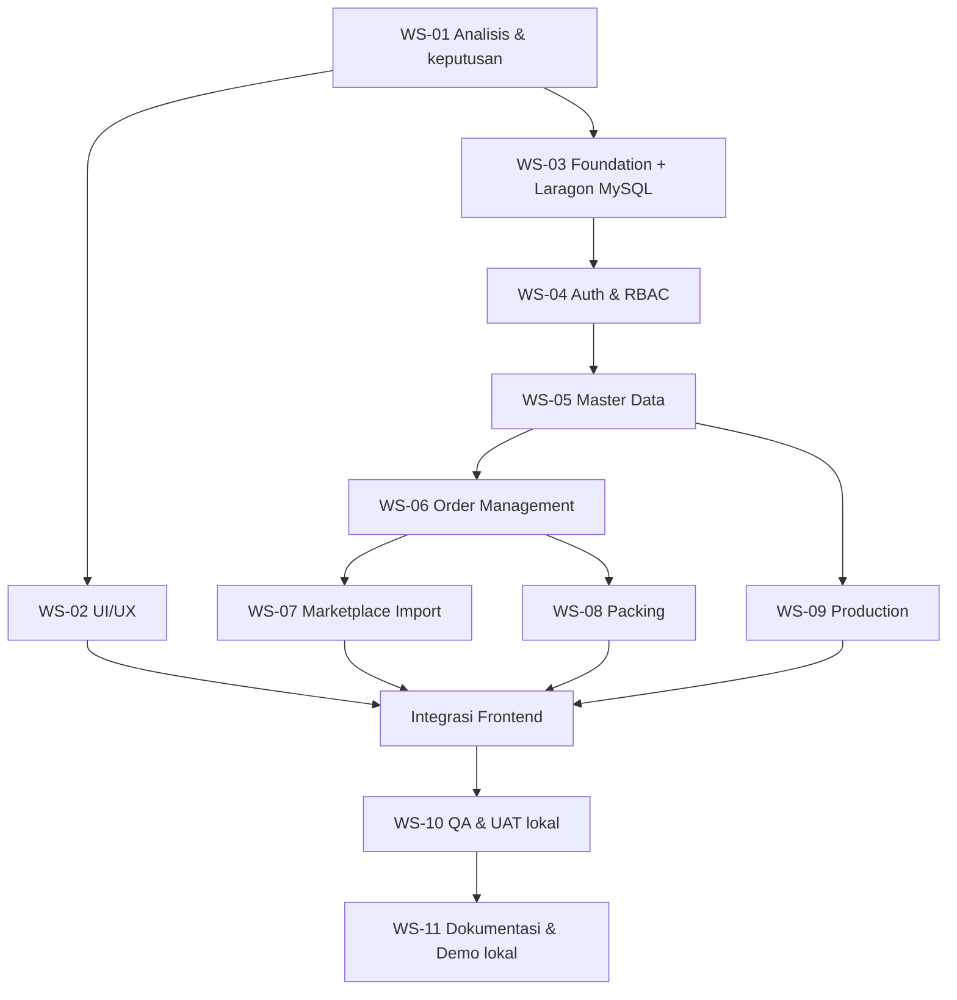

# TASKS.md
## Dekomposisi Pekerjaan — Sistem Pencatatan Pesanan Terpadu Ratu Kriuk

| Metadata | Nilai |
|---|---|
| Versi | 1.1 — Local Development Scope |
| Status | Draft pembagian kerja |
| Acuan | `PRD.md`, `ARCHITECTURE.md`, dan dokumen UML Ratu Kriuk |
| Database development | MySQL melalui Laragon |
| Target | Aplikasi berjalan lokal pada satu komputer terlebih dahulu |

> **Petunjuk:** isi PIC saat tim membagi pekerjaan. Centang `[x]` setelah tugas memenuhi kriteria selesai. Tugas yang bergantung pada keputusan bisnis tidak boleh dianggap final sebelum keputusan tersebut disetujui.

---

## 1. Prioritas dan Aturan Kerja

- **P0 — Blocker:** harus selesai sebelum pekerjaan lain yang bergantung padanya.
- **P1 — MVP:** fitur inti versi pertama.
- **P2 — Quality:** peningkatan kualitas, usability, dan dokumentasi pendukung.
- **P3 — Later:** fitur di luar MVP atau dapat ditunda.

Tambahkan `PIC: Nama` pada tugas yang telah dibagikan.

**Definition of Done umum:**
1. Kode masuk ke branch utama melalui pull request.
2. Lint, typecheck, dan test terkait lulus.
3. Tidak ada secret atau file `.env` yang ikut ter-commit.
4. Perubahan UI mengikuti desain Figma yang disepakati.
5. Dokumentasi terkait diperbarui.
6. Fitur dapat dijalankan dan diuji secara lokal.

## 2. Ringkasan Workstream

| ID | Workstream | Output utama | Prioritas | Status |
|---|---|---|---|---|
| WS-01 | Analisis & keputusan produk | Requirement dan keputusan bisnis final | P0 | ✅ Selesai |
| WS-02 | UI/UX | Figma design system, screens, prototype | P1 | ⏸️ Skip |
| WS-03 | Foundation & local environment | Repo, Next.js, Go API, MySQL Laragon | P0 | ✅ Selesai |
| WS-04 | Authentication & RBAC | Login dan role permission | P1 | ✅ Selesai |
| WS-05 | Master data | Produk dan pelanggan | P1 | 🚧 In Progress |
| WS-06 | Order management | Pesanan manual, kalkulasi, status | P1 | Pending |
| WS-07 | Marketplace import | Upload, validasi, mapping, deduplikasi | P1 | Pending |
| WS-08 | Packing | Daftar packing dan tandai dikemas | P1 | Pending |
| WS-09 | Production | Catat dan pantau batch produksi | P1 | Pending |
| WS-10 | QA & UAT lokal | Automated test dan persetujuan pengguna | P0 | Pending |
| WS-11 | Dokumentasi & local handoff | Panduan menjalankan dan demo lokal | P1 | Pending |

## 3. WS-01 — Analisis dan Keputusan Produk

- [x] **T-001 (P0) Review dokumen UML** - PIC: @AnalisisTim
  - Pelajari Use Case Diagram, UC-01–UC-09, Class Diagram, dan Sequence Diagram.
  - Cocokkan kebutuhan pada PRD dengan dokumen sumber.
  - **Selesai jika:** kebutuhan dan gap/ambiguitas tercatat.

- [x] **T-002 (P0) Finalisasi role dan hak akses** - PIC: @AnalisisTim
  - Tentukan hak Admin/Owner.
  - Tentukan apakah Pegawai dibedakan menjadi bagian packing dan produksi.
  - Tentukan siapa yang mengelola akun pengguna.
  - **Selesai jika:** matriks permission disetujui.

- [x] **T-003 (P0) Finalisasi status pesanan** - PIC: @AnalisisTim
  - Tetapkan status awal dan daftar status final.
  - Tetapkan transisi yang diperbolehkan.
  - Konfirmasi status Dibatalkan dan role yang boleh mengubahnya.
  - **Selesai jika:** state transition matrix disetujui.

- [x] **T-004 (P0) Finalisasi aturan ongkos kirim** - PIC: @AnalisisTim
  - Tentukan apakah ongkir dimasukkan manual atau dihitung dari tabel tarif.
  - Tentukan data tujuan yang wajib disimpan.
  - **Selesai jika:** sumber nilai dan aturan ongkir terdokumentasi.

- [x] **T-005 (P0) Kumpulkan contoh file marketplace** - PIC: @AnalisisTim
  - Minta contoh file ekspor marketplace yang benar-benar digunakan.
  - Identifikasi ekstensi, header, tanggal, nomor pesanan, SKU/nama produk, jumlah, harga, dan ongkir.
  - Tetapkan apakah satu order dapat terdiri dari beberapa baris.
  - **Selesai jika:** tersedia contoh file uji dan spesifikasi mapping.

- [x] **T-006 (P0) Finalisasi aturan pencocokan produk impor** - PIC: @AnalisisTim
  - Pilih kunci pencocokan: SKU, kode internal, atau nama produk.
  - Tetapkan alur untuk produk yang tidak cocok.
  - **Selesai jika:** aturan mapping disetujui.

- [x] **T-007 (P0) Finalisasi tech stack** - PIC: @AnalisisTim
  - Evaluasi bagian 3 `ARCHITECTURE.md`.
  - Sepakati Next.js + TypeScript, Tailwind CSS + shadcn/ui, Go + Gin, MySQL melalui Laragon, TanStack Query, dan Zod atau alternatif yang disepakati.
  - Pastikan versi Node.js, Go, dan MySQL/MariaDB dapat digunakan seluruh anggota.
  - **Selesai jika:** keputusan final dicatat di `ARCHITECTURE.md`.

- [x] **T-008 (P1) Tetapkan acceptance criteria dan scope MVP** - PIC: @AnalisisTim
  - Pastikan setiap use case memiliki skenario sukses dan alternatif.
  - Pisahkan fitur wajib MVP dari fitur tambahan.
  - **Selesai jika:** scope MVP disetujui tim.

## 4. WS-03 — Project Foundation & Local Environment

**Dependensi:** T-007 finalisasi tech stack.

- [ ] **T-021 (P0) Buat repository dan aturan kolaborasi**
  - Buat repository Git.
  - Tentukan branch utama, branch feature, pull request, dan code review.
  - Tambahkan `.gitignore`, `.editorconfig`, dan template issue/PR bila dibutuhkan.
  - **Selesai jika:** seluruh anggota dapat clone dan berkontribusi dengan alur Git yang sama.

- [ ] **T-022 (P0) Samakan lingkungan Laragon dan MySQL**
  - Pastikan setiap komputer development memiliki Laragon dan service MySQL yang dapat dijalankan.
  - Catat versi engine dan port aktual.
  - Buat database lokal `ratu_kriuk`.
  - **Selesai jika:** koneksi database dapat dilakukan dari backend lokal.

- [ ] **T-023 (P0) Scaffold frontend**
  - Inisialisasi Next.js App Router dengan TypeScript.
  - Pasang Tailwind CSS, shadcn/ui, TanStack Query, React Hook Form, dan Zod sesuai stack final.
  - Siapkan struktur route, layout, dan komponen dasar.
  - **Selesai jika:** `npm run dev`, lint, dan typecheck berjalan.

- [ ] **T-024 (P0) Scaffold backend**
  - Inisialisasi Go module dan Gin.
  - Siapkan struktur package per modul.
  - Tambahkan konfigurasi environment, middleware dasar, dan graceful shutdown.
  - **Selesai jika:** API dapat dijalankan lokal dan endpoint health merespons.

- [ ] **T-025 (P0) Implementasi koneksi MySQL Laragon**
  - Pasang `go-sql-driver/mysql`.
  - Buat konfigurasi koneksi melalui environment variables.
  - Tambahkan koneksi pool, ping database, timeout, dan penanganan error.
  - **Selesai jika:** API berhasil terhubung ke database MySQL Laragon.

- [ ] **T-026 (P0) Siapkan migration database**
  - Pilih migration tool yang kompatibel dengan MySQL.
  - Buat migration awal dan mekanisme rollback.
  - Terapkan InnoDB, utf8mb4, DECIMAL untuk uang, dan tipe ID yang konsisten.
  - **Selesai jika:** database baru dapat dibangun dari migration.

- [ ] **T-027 (P0) Siapkan konfigurasi lokal dan contoh environment**
  - Buat `.env.example`.
  - Masukkan `.env`, file upload sementara, dan artefak build ke `.gitignore`.
  - Dokumentasikan host/port dan cara mengubah konfigurasi Laragon.
  - **Selesai jika:** anggota dapat menyiapkan konfigurasi tanpa membagikan secret.

- [ ] **T-028 (P1) Siapkan API contract**
  - Definisikan response sukses/error, pagination, filter, dan konvensi penamaan.
  - Dokumentasikan endpoint berdasarkan `ARCHITECTURE.md`.
  - **Selesai jika:** frontend dan backend menyepakati kontrak API.

- [ ] **T-029 (P1) Siapkan automated checks**
  - Tambahkan format, lint, typecheck, unit test, dan build check.
  - **Selesai jika:** pemeriksaan kode dapat dijalankan secara konsisten oleh tim.

- [ ] **T-030 (P1) Siapkan local run scripts**
  - Sediakan instruksi atau script untuk menjalankan frontend dan backend.
  - Pastikan database Laragon dinyalakan sebelum API.
  - **Selesai jika:** urutan menjalankan aplikasi terdokumentasi dan berhasil diikuti anggota lain.

## 5. WS-04 — Authentication & Authorization

**Dependensi:** WS-03.

- [ ] **T-021 (P0) Buat repository dan aturan kolaborasi**
  - Buat repository Git.
  - Tentukan branch utama, branch feature, pull request, dan code review.
  - Tambahkan `.gitignore`, `.editorconfig`, dan template issue/PR bila dibutuhkan.
  - **Selesai jika:** seluruh anggota dapat clone dan berkontribusi dengan alur Git yang sama.

- [ ] **T-022 (P0) Samakan lingkungan Laragon dan MySQL**
  - Pastikan setiap komputer development memiliki Laragon dan service MySQL yang dapat dijalankan.
  - Catat versi engine dan port aktual.
  - Buat database lokal `ratu_kriuk`.
  - **Selesai jika:** koneksi database dapat dilakukan dari backend lokal.

- [ ] **T-023 (P0) Scaffold frontend**
  - Inisialisasi Next.js App Router dengan TypeScript.
  - Pasang Tailwind CSS, shadcn/ui, TanStack Query, React Hook Form, dan Zod sesuai stack final.
  - Siapkan struktur route, layout, dan komponen dasar.
  - **Selesai jika:** `npm run dev`, lint, dan typecheck berjalan.

- [ ] **T-024 (P0) Scaffold backend**
  - Inisialisasi Go module dan Gin.
  - Siapkan struktur package per modul.
  - Tambahkan konfigurasi environment, middleware dasar, dan graceful shutdown.
  - **Selesai jika:** API dapat dijalankan lokal dan endpoint health merespons.

- [ ] **T-025 (P0) Implementasi koneksi MySQL Laragon**
  - Pasang `go-sql-driver/mysql`.
  - Buat konfigurasi koneksi melalui environment variables.
  - Tambahkan koneksi pool, ping database, timeout, dan penanganan error.
  - **Selesai jika:** API berhasil terhubung ke database MySQL Laragon.

- [ ] **T-026 (P0) Siapkan migration database**
  - Pilih migration tool yang kompatibel dengan MySQL.
  - Buat migration awal dan mekanisme rollback.
  - Terapkan InnoDB, utf8mb4, DECIMAL untuk uang, dan tipe ID yang konsisten.
  - **Selesai jika:** database baru dapat dibangun dari migration.

- [ ] **T-027 (P0) Siapkan konfigurasi lokal dan contoh environment**
  - Buat `.env.example`.
  - Masukkan `.env`, file upload sementara, dan artefak build ke `.gitignore`.
  - Dokumentasikan host/port dan cara mengubah konfigurasi Laragon.
  - **Selesai jika:** anggota dapat menyiapkan konfigurasi tanpa membagikan secret.

- [ ] **T-028 (P1) Siapkan API contract**
  - Definisikan response sukses/error, pagination, filter, dan konvensi penamaan.
  - Dokumentasikan endpoint berdasarkan `ARCHITECTURE.md`.
  - **Selesai jika:** frontend dan backend menyepakati kontrak API.

- [ ] **T-029 (P1) Siapkan automated checks**
  - Tambahkan format, lint, typecheck, unit test, dan build check.
  - **Selesai jika:** pemeriksaan kode dapat dijalankan secara konsisten oleh tim.

- [ ] **T-030 (P1) Siapkan local run scripts**
  - Sediakan instruksi atau script untuk menjalankan frontend dan backend.
  - Pastikan database Laragon dinyalakan sebelum API.
  - **Selesai jika:** urutan menjalankan aplikasi terdokumentasi dan berhasil diikuti anggota lain.

## 6. WS-04 — Authentication & Authorization

**Dependensi:** WS-03.

- [ ] **T-031 (P1) Buat tabel dan model pengguna**
  - Implementasikan users, role, password hash, dan status akun.
  - **Selesai jika:** migration dan repository user tersedia.

- [ ] **T-032 (P1) Implementasi login**
  - Validasi username/password.
  - Hash dan verifikasi password dengan Argon2id.
  - Buat session/cookie atau token sesuai rancangan.
  - **Selesai jika:** kredensial valid menghasilkan autentikasi.

- [ ] **T-033 (P1) Implementasi logout dan current user**
  - Buat endpoint logout dan identitas pengguna aktif.
  - **Selesai jika:** sesi dapat diakhiri dan status autentikasi diperiksa.

- [ ] **T-034 (P1) Implementasi middleware authentication**
  - Lindungi endpoint privat.
  - Tangani sesi/token tidak valid atau kedaluwarsa.
  - **Selesai jika:** request tanpa autentikasi ditolak.

- [ ] **T-035 (P1) Implementasi RBAC**
  - Terapkan permission Admin/Owner, Pegawai Packing, dan Pegawai Produksi sesuai T-002.
  - **Selesai jika:** user tidak dapat mengakses endpoint di luar haknya.

- [ ] **T-036 (P1) Integrasi UI login dan protected routes**
  - Hubungkan form login, loading, error, logout, dan pengalihan dashboard berdasarkan role.
  - **Selesai jika:** login dan logout berjalan end-to-end secara lokal.

## 7. WS-05 — Master Data

**Dependensi:** WS-04.

- [ ] **T-037 (P1) Buat database dan repository produk**
  - Field minimum: ID, SKU bila digunakan, nama, harga, status aktif, timestamps.
  - Constraint harga non-negatif dan keunikan SKU bila digunakan.
  - **Selesai jika:** migration dan integration test lulus.

- [ ] **T-038 (P1) Implementasi API produk**
  - Daftar, detail, tambah, dan ubah produk.
  - Search, filter aktif, pagination.
  - **Selesai jika:** validasi dan permission bekerja.

- [ ] **T-039 (P1) Buat database dan repository pelanggan**
  - Field minimum: nama, kontak, alamat/tujuan pengiriman, timestamps.
  - **Selesai jika:** migration dan integration test lulus.

- [ ] **T-040 (P1) Implementasi API pelanggan**
  - Daftar, detail, tambah, dan ubah pelanggan.
  - Search dan pagination.
  - **Selesai jika:** validasi dan permission bekerja.

- [ ] **T-041 (P1) Implementasi UI produk**
  - Tabel, search, tambah, edit, validasi, loading, empty, dan error state.
  - **Selesai jika:** pengelolaan produk dapat dilakukan dari UI.

- [ ] **T-042 (P1) Implementasi UI pelanggan**
  - Tabel, search, tambah, edit, validasi, loading, empty, dan error state.
  - **Selesai jika:** pengelolaan pelanggan dapat dilakukan dari UI.

## 8. WS-06 — Order Management

**Dependensi:** WS-04 dan WS-05.

- [ ] **T-043 (P1) Buat model dan database pesanan**
  - Implementasikan orders, order_items, foreign key, indeks, dan constraint.
  - Simpan snapshot nama/harga produk pada detail pesanan.
  - **Selesai jika:** migration dan relasi database tervalidasi.

- [ ] **T-044 (P1) Implementasi domain kalkulasi pesanan**
  - Hitung subtotal, total produk, ongkir, dan total pembayaran.
  - Gunakan DECIMAL/fixed precision untuk nilai uang.
  - **Selesai jika:** unit test mencakup nilai normal dan input tidak valid.

- [ ] **T-045 (P1) Implementasi API pembuatan pesanan manual**
  - Validasi pelanggan, produk, kuantitas, tujuan, dan ongkir.
  - Ambil harga dari database; jangan percaya harga dari frontend.
  - Simpan pesanan dan item dalam satu transaksi.
  - **Selesai jika:** kegagalan penyimpanan tidak meninggalkan pesanan parsial.

- [ ] **T-046 (P1) Implementasi API daftar dan detail pesanan**
  - Search nomor pesanan/pelanggan.
  - Filter tanggal, status, dan sumber.
  - Pagination dan detail item.
  - **Selesai jika:** filter dan pagination diuji.

- [ ] **T-047 (P1) Implementasi status history dan state machine**
  - Terapkan transisi hasil T-003.
  - Catat status lama/baru, actor, timestamp, dan catatan bila diperlukan.
  - **Selesai jika:** transisi ilegal ditolak dan histori tercatat dalam transaksi.

- [ ] **T-048 (P1) Implementasi API ubah status**
  - Validasi status terbaru dan permission.
  - Tangani konflik ketika status berubah bersamaan.
  - **Selesai jika:** konflik dapat ditangani UI.

- [ ] **T-049 (P1) Implementasi UI daftar dan detail pesanan**
  - Tabel, filter, search, pagination, detail, histori status.
  - **Selesai jika:** data dapat dibaca dan difilter.

- [ ] **T-050 (P1) Implementasi UI input pesanan manual**
  - Pelanggan, produk, kuantitas, tujuan, ongkir, ringkasan total, konfirmasi.
  - **Selesai jika:** pesanan dapat dibuat end-to-end.

- [ ] **T-051 (P1) Implementasi UI ubah status**
  - Pilih status yang diizinkan, konfirmasi, feedback, dan refresh data.
  - **Selesai jika:** perubahan terlihat di detail dan daftar.

## 9. WS-07 — Marketplace Import

**Dependensi:** T-005, T-006, WS-03, WS-05, dan model order T-043.

- [ ] **T-052 (P1) Tentukan file contract**
  - Tetapkan format dan kolom berdasarkan contoh file marketplace.
  - Buat header mapping dan normalisasi data.
  - **Selesai jika:** contoh file dapat diparsing secara konsisten.

- [ ] **T-053 (P1) Implementasi upload file aman**
  - Allowlist ekstensi/MIME, batas ukuran, nama file aman, penyimpanan sementara lokal.
  - **Selesai jika:** file tidak sesuai aturan ditolak.

- [ ] **T-054 (P1) Implementasi parser dan row validator**
  - Validasi header, nomor pesanan, data pelanggan, produk, kuantitas, harga, tanggal, dan kolom wajib sesuai file contract.
  - **Selesai jika:** error mencantumkan nomor baris dan penyebab.

- [ ] **T-055 (P1) Implementasi product mapping**
  - Cocokkan SKU/kode/nama sesuai T-006.
  - Catat produk tidak cocok sebagai gagal.
  - **Selesai jika:** mapping dan kegagalan dapat ditelusuri.

- [ ] **T-056 (P1) Implementasi deduplikasi dan idempotency**
  - Normalisasi external order number.
  - Gunakan unique constraint dan penanganan conflict.
  - **Selesai jika:** file yang diimpor ulang tidak membuat pesanan duplikat.

- [ ] **T-057 (P1) Implementasi import job dan hasil per baris**
  - Simpan status job serta hasil `SUCCESS`, `FAILED`, atau `DUPLICATE`.
  - Simpan ringkasan jumlah total, berhasil, gagal, dan duplikat.
  - **Selesai jika:** hasil impor dapat ditinjau.

- [ ] **T-058 (P1) Implementasi penyimpanan pesanan impor**
  - Simpan satu pesanan dan item-itemnya secara atomik.
  - Baris valid tetap diproses walau baris lain gagal.
  - **Selesai jika:** partial success sesuai aturan dan data konsisten.

- [ ] **T-059 (P1) Implementasi API import**
  - Upload/start import, status job, dan hasil tiap baris.
  - **Selesai jika:** kontrak API dan permission Admin bekerja.

- [ ] **T-060 (P1) Implementasi UI import**
  - Upload, preview/mapping, konfirmasi, progress, ringkasan, tabel hasil dan alasan gagal.
  - **Selesai jika:** Admin dapat menyelesaikan impor dari UI.

## 10. WS-08 — Packing Operations

**Dependensi:** T-003, T-035, T-043, T-047, dan T-048.

- [ ] **T-061 (P1) Implementasi query daftar packing**
  - Ambil pesanan yang memenuhi definisi “belum dikemas”.
  - Sertakan informasi minimum untuk operasional.
  - **Selesai jika:** pesanan batal/selesai tidak masuk antrean packing.

- [ ] **T-062 (P1) Implementasi detail pesanan packing**
  - Tampilkan item, kuantitas, dan informasi yang diperlukan.
  - Batasi data pelanggan sesuai permission.
  - **Selesai jika:** pegawai dapat memeriksa barang yang perlu dikemas.

- [ ] **T-063 (P1) Implementasi aksi tandai dikemas**
  - Validasi status terbaru.
  - Cegah aksi untuk pesanan sudah dikemas atau dibatalkan.
  - Update status dan histori dalam satu transaksi.
  - **Selesai jika:** aksi aman terhadap klik ganda dan perubahan bersamaan.

- [ ] **T-064 (P1) Implementasi UI daftar packing**
  - Daftar, pencarian/filter ringan, empty, loading, dan error state.
  - **Selesai jika:** pegawai dapat menemukan pesanan yang perlu dikemas.

- [ ] **T-065 (P1) Implementasi UI detail dan konfirmasi packing**
  - Detail item, tombol Tandai Dikemas, konfirmasi, toast, pembaruan daftar.
  - **Selesai jika:** flow packing berjalan end-to-end.

## 11. WS-09 — Production Records

**Dependensi:** T-035, T-037, dan desain T-018.

- [ ] **T-066 (P1) Implementasi tabel dan repository batch produksi**
  - Relasi ke produk dan pengguna pencatat.
  - Setiap submit menghasilkan record baru.
  - **Selesai jika:** batch produk/tanggal sama tetap tersimpan terpisah.

- [ ] **T-067 (P1) Implementasi API catat produksi**
  - Validasi produk aktif, jumlah positif, tanggal, dan metadata batch sesuai keputusan.
  - **Selesai jika:** record baru dibuat dengan actor dan timestamp.

- [ ] **T-068 (P1) Implementasi API daftar/detail batch**
  - Filter tanggal dan produk, pagination, dan detail.
  - **Selesai jika:** Admin dapat memantau hasil produksi.

- [ ] **T-069 (P1) Implementasi UI form catat produksi**
  - Pilih produk, jumlah, tanggal, metadata batch/catatan sesuai scope.
  - **Selesai jika:** pegawai dapat mencatat batch dari UI.

- [ ] **T-070 (P1) Implementasi UI hasil produksi Admin**
  - Tabel, filter, ringkasan kuantitas, dan detail batch.
  - **Selesai jika:** catatan dapat dipantau tanpa menimpa batch.

## 12. WS-10 — Quality Assurance

QA dilakukan sepanjang pengembangan, bukan hanya pada akhir.

- [ ] **T-071 (P1) Unit test domain**
  - Kalkulasi pesanan, validasi kuantitas, transisi status, parser/mapping, deduplikasi, dan batch produksi.
  - **Selesai jika:** semua aturan bisnis kritis memiliki test.

- [ ] **T-072 (P1) Integration test MySQL**
  - Repository, transaksi order, constraint, auth, RBAC, impor, dan update status.
  - Jalankan pada MySQL yang kompatibel dengan versi Laragon tim.
  - **Selesai jika:** skenario database nyata lulus.

- [ ] **T-073 (P1) API test**
  - Uji success, validation error, unauthorized, forbidden, not found, dan conflict.
  - **Selesai jika:** kontrak API konsisten.

- [ ] **T-074 (P1) E2E test alur utama**
  - Login Admin/Pegawai.
  - Input pesanan manual.
  - Impor marketplace.
  - Ubah status.
  - Packing.
  - Catat produksi.
  - **Selesai jika:** alur inti dapat dijalankan dari UI sampai database.

- [ ] **T-075 (P1) Uji alternatif dan edge cases**
  - Kredensial salah, field kosong, produk tidak ditemukan, quantity invalid, file salah, baris invalid, duplikat, status ilegal, pesanan batal, penyimpanan gagal.
  - **Selesai jika:** respons sistem tepat dan data tetap konsisten.

- [ ] **T-076 (P1) Uji responsive dan usability**
  - Periksa desktop, tablet, dan mobile untuk halaman penting.
  - **Selesai jika:** tidak ada masalah layout yang menghalangi alur inti.

- [ ] **T-077 (P0) UAT lokal bersama pengguna**
  - Jalankan UC-01 sampai UC-09 bersama Admin/Owner dan Pegawai.
  - Catat temuan dan persetujuan.
  - **Selesai jika:** temuan kritis diselesaikan dan UAT disetujui.

- [ ] **T-078 (P0) Bug fixing dan regression test**
  - Perbaiki bug QA/UAT dan ulangi test yang terdampak.
  - **Selesai jika:** tidak ada bug blocker/critical yang diketahui.

## 13. WS-11 — Dokumentasi dan Local Handoff

- [ ] **T-079 (P1) Buat README setup lokal**
  - Prasyarat Node.js, Go, Git, dan Laragon.
  - Cara menjalankan MySQL, membuat database, mengisi `.env`, menjalankan migration, backend, dan frontend.
  - Cara menjalankan test.
  - **Selesai jika:** anggota lain dapat menyiapkan project hanya dengan mengikuti README.

- [ ] **T-080 (P1) Buat dokumentasi database**
  - ERD final, migration, tabel, relasi, constraint, dan seed data development.
  - **Selesai jika:** struktur database mudah dipahami dan dapat dibuat ulang.

- [ ] **T-081 (P1) Buat panduan pengguna singkat**
  - Login, kelola data, input pesanan, impor marketplace, packing, dan catat produksi.
  - **Selesai jika:** pengguna dapat mencoba fungsi inti tanpa pendampingan teknis terus-menerus.

- [ ] **T-082 (P1) Siapkan demo aplikasi lokal**
  - Siapkan data dummy, akun Admin/Pegawai, dan contoh file impor.
  - Pastikan tidak menggunakan data pelanggan asli untuk demo.
  - **Selesai jika:** seluruh use case dapat didemonstrasikan secara lokal.

**Tidak termasuk tugas MVP:** deploy VPS/cloud, domain publik, CI/CD deployment online, dan monitoring production. Evaluasi hal tersebut setelah aplikasi lokal selesai diuji.

## 14. Urutan Pengerjaan dan Dependensi

Beberapa pekerjaan UI dapat dikerjakan paralel setelah design tokens dan kontrak API cukup stabil. Jangan mengintegrasikan UI ke API yang belum memiliki kontrak yang disepakati.

## 15. Checklist Milestone

### M0 — Keputusan dan Setup
- [ ] Role, status, ongkir, file impor, dan tech stack disepakati.
- [ ] Repository tersedia.
- [ ] Laragon MySQL dapat diakses dari Go API.
- [ ] Next.js dan Go API dapat dijalankan lokal.
- [ ] Migration database berjalan.

### M1 — Fondasi dan Master Data
- [ ] Login dan RBAC selesai.
- [ ] CRUD produk selesai.
- [ ] CRUD pelanggan selesai.
- [ ] UI dasar dan navigasi role tersedia.

### M2 — Order Management
- [ ] Input pesanan manual selesai.
- [ ] Kalkulasi subtotal, ongkir, dan total diuji.
- [ ] Daftar dan detail pesanan selesai.
- [ ] Update status dan status history selesai.

### M3 — Operasional
- [ ] Impor marketplace dan deduplikasi selesai.
- [ ] Daftar packing selesai.
- [ ] Tandai Dikemas selesai.
- [ ] Catat dan pantau batch produksi selesai.

### M4 — Validasi dan Handoff Lokal
- [ ] Automated test lulus.
- [ ] UAT lokal selesai.
- [ ] Bug kritis ditutup.
- [ ] README dan panduan pengguna tersedia.
- [ ] Demo lokal siap.

## 16. Catatan Pembagian Tim

Isi tabel ini ketika menentukan PIC. Pembagian disarankan berdasarkan workstream agar tanggung jawab dan review jelas.

| Workstream | PIC | Reviewer | Catatan |
|---|---|---|---|---|
| Analisis & keputusan | @SeniorDesigner, @ProductOwner | @SeniorDesigner | T-001~T-008 diselesaiakan |
| UI/UX Figma | @SeniorDesigner | @DesignLead | T-009~T-015 |
| Frontend foundation | @FrontendDev, @BackendDev | @FrontendLead | T-023~T-030 |
| Backend foundation & database | @BackendDev | @DBAdmin | T-043~T-050 |
| Authentication & master data | @AuthLead, @DataMgr | @SecurityLead | T-031~T-042 |
| Order management | @OrderMgr, @Admin | @OrderLead | T-043~T-051 |
| Marketplace import | @ImportLead, @DataMgr | @ImportLead | T-052~T-059 |
| Packing & production | @PackingDev, @ProdDev | @PackingLead | T-061~T-065 |
| QA, dokumentasi, demo | @QALead, @Docs | @QALead | T-071~T-077 |

---
**Catatan:** task ini diturunkan dari PRD, rancangan arsitektur, dan artefak UML. Aturan yang belum dijelaskan oleh dokumen sumber ditandai sebagai keputusan yang harus disepakati. Scope pengerjaan saat ini dibatasi pada aplikasi lokal dengan MySQL melalui Laragon.
